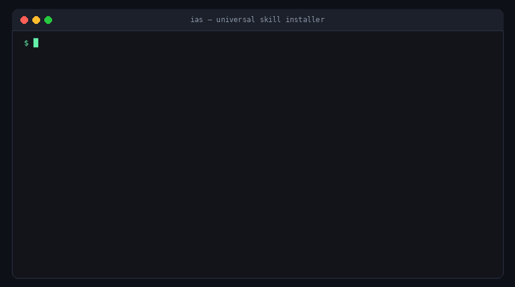

# install-anything-skill (`ias`)

> **The 1-command installer for AI coding agents that turns any GitHub repository into an active skill.**

[](https://github.com/Ayan-Jain-737/install-anything-skill/actions/workflows/ci.yml)
[](https://www.npmjs.com/package/install-anything-skill)
[](LICENSE)
[](https://nodejs.org/)
[](https://github.com/Ayan-Jain-737/install-anything-skill/discussions)

```bash
npm i -g install-anything-skill
```
*Or via curl installer:* `curl -fsSL https://raw.githubusercontent.com/Ayan-Jain-737/install-anything-skill/main/scripts/install.sh | bash`

<div align="center">



**[🌐 Try the Live Interactive Playground](https://install-anything-skill.netlify.app)**

</div>

> [!TIP]
> **🚀 What's New in v3.1.0**:
> - **Zero-Clone Architecture**: Streams tarballs (`/archive/HEAD.tar.gz`) directly to extract prompt skills without full git history cloning.
> - **Deterministic Binary Releases**: Downloads release binaries straight to `~/.local/bin/` with `eget`-style OS/Arch heuristics (`ias install BurntSushi/ripgrep`).
> - **7-Archetype Intelligent Triage (`ias inspect`)**: Pre-inspects repositories via raw CDN manifests to pick the ideal install path.
> - **Comprehensive `SKILL.md` Synthesis**: Generates in-depth operational manuals from real CLI `--help` flags.
> - **Fullstack Web-App Service Manuals**: Synthesizes Docker run and API instructions without downloading bloated frontend bundles (`ias install anil-matcha/open-generative-ai`).
> - **Interactive Human Handoff**: Produces markdown guides when complex non-AI apps require human configuration.
> - **Project-Local Scoping (`--scope local` / `-p`)**: Registers skills to `./.agents/skills/` without touching home directories.
> - **Built-in Self-Updater (`ias update`)**: 1-command upgrade with non-blocking 24-hr update notifications.

> [!NOTE]
> **Package Renamed & Migration**: This package was formerly published as `enlighten-agent-tool`. It has been renamed and upgraded to **`install-anything-skill`**, callable everywhere via the short acronym **`ias`** (and `install-anything`). The previous package `enlighten-agent-tool` is deprecated.

## Universal GitHub Repository & Skill Installer for AI Agents

**ias** (`install-anything-skill`) is an autonomous skill and repository installer for AI agent harnesses. Callable everywhere by the simple acronym **`ias`**, it installs in **one command**, automatically registers itself in your active agent's skills folder, discovers community skills across the open registry, and turns **any GitHub repository** into an immediately executable tool for your agent—compiling binaries, synthesizing skill wrappers, and scoping changes cleanly to your active agent.

<div align="center">

| ✅ Core Capabilities | 🔧 Platform Support | 🌐 Build & Package Managers |
|----------------------|---------------------|-----------------------------|
| **Built-in Skill Discovery** (`ias find`) | **Claude Code** (`~/.claude/skills/ias`) | npm, yarn, pnpm, bun |
| **Active-Agent Scoping** (Zero ghost folders) | **Open Agents** (`~/.agents/skills/ias`) | pip, uv, poetry, pipenv |
| **Auto-Synthesis for Repos without SKILL.md** | **Cursor & Codex** (`~/.cursor/`, `~/.codex/`) | cargo (Rust compilation) |
| **README-First Intelligence** | **Hermes & OpenCode** (`~/.hermes/`, `~/.config/opencode/`) | go build, go install |
| **Executable Binary Symlinks** (`~/.local/bin/ias`) | **Gemini & Antigravity** (`~/.gemini/skills/ias`) | gradle, maven |
| **Full Lifecycle & Safe Rollback** | **Zed & Custom Agent Harnesses** | cmake, make |

</div>

---

## 🆚 Head-to-Head: ias vs Traditional `npx skills`

| Capability | Traditional Skills CLI (`npx skills`) | ias (`install-anything-skill`) |
| :--- | :--- | :--- |
| **Zero-Clone Architecture** | ❌ Full git clone of every repo | ✅ **Direct tarball streaming & binary downloads (Zero clones)** |
| **Direct Binary Releases** | ❌ Cannot download release assets | ✅ **`eget`-style binary matcher & installer to `~/.local/bin`** |
| **Fullstack & Monorepos** | ❌ Clones gigabytes of dead files | ✅ **Synthesizes operational service manual + Docker recipes** |
| **Interactive Human Handoff** | ❌ Silent failure or hanging prompts | ✅ **Detailed markdown guide when user action is required** |
| **Repos without `SKILL.md`** | ❌ Cannot install | ✅ **Auto-synthesizes deep multi-section manual with `--help`** |
| **Project-Local Scoping** | ❌ Global dump only | ✅ **Supports `--scope local` (`-p`) to `./.agents/skills/`** |
| **Selective Extraction** | ❌ All or nothing | ✅ **Glob pattern filtering with `--skills "react-*"`** |
| **API Rate-Limit Immunity** | ❌ 60 req/hr GitHub REST limit | ✅ **Bypasses limits via raw CDN & direct release download redirects** |
| **Active Agent Directory Scoping** | ❌ Dumps into single generic folder | ✅ **Scopes to active caller agent (Claude, Cursor, Codex, Gemini, etc.)** |
| **Zero Clutter Discipline** | ❌ May leave unused agent folders | ✅ **Never creates folders for unused agents** |
| **Skill Discovery** | ✅ Remote registry search | ✅ **Live registry + Curated + Offline fallback** |
| **Machine-Readable Agent JSON** | ❌ Plain terminal text | ✅ **Structured JSON with `--json` for agent workflows** |

---

## 🚀 1-Command Installation

Anyone can install install-anything in a single command using any of these methods:

### Method 1: Universal Shell One-Liner (Recommended)
```bash
curl -fsSL https://raw.githubusercontent.com/Ayan-Jain-737/install-anything-skill/main/scripts/install.sh | bash
```

### Method 2: Open Agent Skills CLI
```bash
npx skills add Ayan-Jain-737/install-anything-skill -g -y
```

### Method 3: NPM Global Install
```bash
npm install -g install-anything-skill
```

### Method 4: From Local Clone
```bash
git clone https://github.com/Ayan-Jain-737/install-anything-skill.git
cd install-anything-skill
./scripts/install.sh
```

### What Happens on Installation:
- ✅ Links the `ias` executable directly to `~/.local/bin/ias` (along with `install-anything`, `install-anything-skill`, and `enlighten`).
- ✅ Registers skills directly into your active agent's folder (e.g., `~/.claude/skills/`, `~/.cursor/skills/`, `~/.gemini/skills/`, `~/.hermes/skills/`) and global canonical storage (`~/.agents/skills/`), avoiding ghost folders for unused agents.
- ✅ Installs slash command `/ias` and `/install-anything` for supported agents (Claude Code, Hermes).
- ✅ Updates `~/.agents/.skill-lock.json`.

---

## ⚡ Quick Start

```bash
# 1. Discover skills & CLI tools across the open ecosystem
ias find react
ias find testing
ias find --json

# 2. Inspect repository archetype & install plan before modifying disk
ias inspect anil-matcha/open-generative-ai
ias inspect BurntSushi/ripgrep
ias inspect --json

# 3. Install any GitHub repository (cleanly scoped to active agent & global store)
# Prompt skill pack (zero-clone tarball stream)
ias install vercel-labs/agent-skills

# Selective skill extraction using glob patterns
ias install vercel-labs/agent-skills --skills "react-*,tdd*"

# Project-local installation (registers to ./.agents/skills/ instead of ~/.agents)
ias install user/repo --scope local
# or shorthand:
ias install user/repo -p

# Binary release download (zero-clone direct executable installation to ~/.local/bin)
ias install BurntSushi/ripgrep

# Fullstack app service manual synthesis without repository bloat
ias install anil-matcha/open-generative-ai

# Explicitly target a specific agent harness (claude, cursor, codex, gemini, hermes, opencode, etc.)
ias install https://github.com/user/repo --agent claude

# Preview installation without making changes (dry-run)
ias install https://github.com/user/repo --dry-run

# Output machine-readable JSON for agent consumption
ias install https://github.com/user/repo --json

# 4. Diagnose repository before installing
ias diagnose https://github.com/user/repo

# 5. List all managed repositories, binaries, and registered skills
ias list-installed

# 6. Safely remove a repository, unregister skills, and unlink binaries
ias uninstall <identifier> --force
```

### Using Inside Agent Conversations
Any AI agent that has loaded the `ias` skill can run:
```bash
/ias find react
/ias install https://github.com/user/repo
```
or execute via the terminal tool:
```bash
ias find <query>
ias install <repo-url>
```

---

## 🧠 How Intelligent Archetype Triage & Zero-Clone Scoping Works (v3.1)

When an agent or developer runs `ias install <repo-url>`:

```
┌────────────────────────────────────────────────────────┐
│ 1. Rate-Limit-Immune Manifest Triage (ias inspect)     │
│    Inspects raw CDN manifests, releases & README       │
└──────────────────────────┬─────────────────────────────┘
                           │
┌──────────────────────────▼─────────────────────────────┐
│ 2. 7-Archetype Classification                          │
│    Classifies into skill-pack, cli-binary, web-app,    │
│    cli-source, mcp-server, library, or mixed-meta      │
└──────────────────────────┬─────────────────────────────┘
                           │
             Which Archetype?
            ┌──────────────┼─────────────────────────────┐
            │              │                             │
    [skill-pack]     [cli-binary]                   [web-app]
┌───────────▼─────┐┌───────▼────────────────────┐┌───────▼──────────────────────┐
│ Zero-Clone Tar  ││ Deterministic eget Matcher ││ Operational Service Manual   │
│ Stream archive  ││ Downloads binary release   ││ Generates Docker run & API   │
│ & extract skills││ directly to ~/.local/bin/  ││ recipes without app bloat    │
└───────────┬─────┘└───────┬────────────────────┘└───────┬──────────────────────┘
            │              │                             │
            └──────────────┼─────────────────────────────┘
                           │
┌──────────────────────────▼─────────────────────────────┐
│ 3. Deep Skill Synthesis (If no SKILL.md found)         │
│    Extracts real --help flags, subcommands & recipes   │
│    into an exhaustive, actionable operational manual   │
└──────────────────────────┬─────────────────────────────┘
                           │
┌──────────────────────────▼─────────────────────────────┐
│ 4. Scoped Registration & Atomic Locking                │
│    • Active Agent: Claude, Gemini, Cursor, Hermes      │
│    • Project-Local: ./.agents/skills/ (--scope local)  │
│    • Zero ghost directories in unused agent folders    │
│    • Atomic directory spinlocks (.lock) prevent races  │
└────────────────────────────────────────────────────────┘
```

---

## 📋 Commands

| Command | Description |
|---------|-------------|
| `ias find <query>` | Discover agent skills, packages, and CLI tool repos (e.g., `ias find react`) |
| `ias inspect <url>` | Preview repository archetype, detected skills, and install plan without modifying disk |
| `ias install <url>` | Zero-clone install repository, compile binaries, and register skills |
| `ias install <url> -p` | Install in **project-local** scope (`./.agents/skills/`) instead of user home |
| `ias install <url> --skills "glob*"` | Filter and install only specific matching skills (e.g. `--skills "react-*"`) |
| `ias install <url> --agent <name>` | Explicitly target an agent harness (e.g. `claude`, `cursor`, `gemini`, `hermes`) |
| `ias diagnose <url>` | Analyze repository without installing (README guide, languages, frameworks, skills) |
| `ias list-installed` | Show all managed installations, exposed binaries, and registered skills |
| `ias update` | Self-update `ias` to latest npm release and sync all registered skills |
| `ias uninstall <id> --force` | Safe removal of repository, binaries (`~/.local/bin`), and registered skills |
| `ias --help` | Show command line help and options (alias: `install-anything`) |

---

## 🌐 Supported Platforms & Active Directory Scoping

`ias` works across the entire AI agent ecosystem. It automatically detects the active harness at runtime, or lets you target any harness with `--agent <name>`.

| Agent Framework | Skills Directory | Scoping & Integration Behavior |
|-----------------|------------------|--------------------------------|
| **Claude Code** | `~/.claude/skills/ias` | Skills directory & `~/.claude/commands/ias.md` (`/ias`) |
| **Open Agents** | `~/.agents/skills/ias` & `.skill-lock.json` | Canonical global store (`npx skills` compatible) |
| **Project-Local** | `./.agents/skills/` & `./.skill-lock.json` | Project-local workspace isolation (`--scope local` / `-p`) |
| **Cursor** | `~/.cursor/skills/` | Automatic runtime detection & targeted on demand (`--agent cursor`) |
| **Codex** | `~/.codex/skills/` | Automatic runtime detection & targeted on demand (`--agent codex`) |
| **Hermes** | `~/.hermes/skills/ias` | Skills directory & `~/.hermes/commands/ias.md` (`/ias`) |
| **OpenCode** | `~/.config/opencode/skills/` | Config plugin / skill directory |
| **Antigravity / Gemini** | `~/.gemini/skills/ias` | Automatic runtime detection (`ANTIGRAVITY_AGENT`, `GEMINI_CLI`) |
| **Zed** | `~/.zed/skills/` | Targeted on demand (`--agent zed`) |
| **Custom / Headless** | `~/.agents/skills/` | Works with any agent reading standard `SKILL.md` directories |

---

## 🏗️ Architecture

```
install-anything-skill/
├── bin/
│   ├── ias                          # Short acronym executable with 24h update checker
│   └── install-anything             # Full CLI executable
├── skills/
│   ├── ias/                         # Primary acronym agent skill
│   │   ├── SKILL.md
│   │   └── scripts/dispatch.js
│   ├── install-anything/            # Full-name agent skill definition
│   │   ├── SKILL.md
│   │   └── scripts/dispatch.js
│   ├── install-anything-installer/  # Scanner, adapter, triage & skill registry engine
│   │   ├── SKILL.md
│   │   └── scripts/
│   │       ├── scan-repo.js         # Deep repo & skill scanner
│   │       ├── skill-finder.js      # Skill & CLI tool discovery engine
│   │       ├── skill-registry.js    # Multi-harness active-scoped registration & synthesis manager
│   │       ├── adapt-install.js     # Zero-clone tarball stream & binary downloader adapter
│   │       └── readme-guide.js      # Rate-limit-safe 7-archetype triage engine & human handoff reporter
│   └── install-anything-uninstaller/# Safe removal skill
│       └── SKILL.md
├── commands/
│   ├── ias.md                       # /ias slash command
│   └── install-anything.md          # /install-anything slash command
├── scripts/
│   ├── install.sh                   # Universal 1-command curl installer
│   ├── install.js                   # Node.js self-registration script
│   └── postinstall.js               # NPM postinstall hook
├── tests/
│   ├── test-concurrency.js          # Concurrency stress tests with directory spinlocks
│   ├── test-triage.js               # 7-archetype classification & CDN caching tests
│   ├── test-releases.js             # eget-style release asset matcher tests
│   ├── test-synthesis.js            # In-depth operational manual synthesis tests
│   ├── test-zero-clone.js           # Tarball streaming and binary download tests
│   ├── test-security-audit.js       # ZipSlip, path traversal & token isolation tests
│   ├── test-e2e-matrix.js           # Multi-harness E2E matrix verification tests
│   ├── test-scanner.js              # Scanner unit tests
│   ├── test-skills.js               # Multi-harness skill registration tests
│   ├── test-finder.js               # SkillFinder & discovery engine tests
│   └── test-lifecycle.js            # End-to-end install/uninstall lifecycle tests
├── package.json
└── README.md
```

---

## 🧪 Testing

Run the full 11-suite test suite with:

```bash
npm test
```

Includes:
- **Concurrency & Spinlocks**: 5 parallel worker processes testing simultaneous lock acquisition with zero file corruption.
- **Triage & CDN Caching**: Validates archetype classification across CLI tools, prompt packs, fullstack apps, and broken manifests.
- **Zero-Clone Streaming**: Confirms tarball extraction and platform binary asset matching without git clones.
- **Operational Manual Synthesis**: Verifies deep multi-section `SKILL.md` generation.
- **Security Audit**: Validates ZipSlip, path traversal, token isolation, and child process security.
- **Multi-Harness E2E Matrix**: Tests real repo inspections and simulations for Claude Code, Hermes, and Gemini/Antigravity harnesses.

---

## 🤝 Contributing & Community

We welcome contributions from everyone!

- 🌟 **First time?** Check out our [Good First Issues](.github/GOOD_FIRST_ISSUES.md).
- 🛠️ **Development Guide**: Read the [Contributing Guide](CONTRIBUTING.md) for local setup, test execution, and PR workflow.
- 💬 **Discussions**: Have questions or ideas? Join our [GitHub Discussions](https://github.com/Ayan-Jain-737/install-anything-skill/discussions).
- ⏱️ **Our Promise**: Maintainers review and respond to every opened issue and PR within 24 hours.

---

## 📄 License

MIT License © 2024-2026 [Ayan Jain](https://github.com/Ayan-Jain-737). See [LICENSE](LICENSE) for full details.
